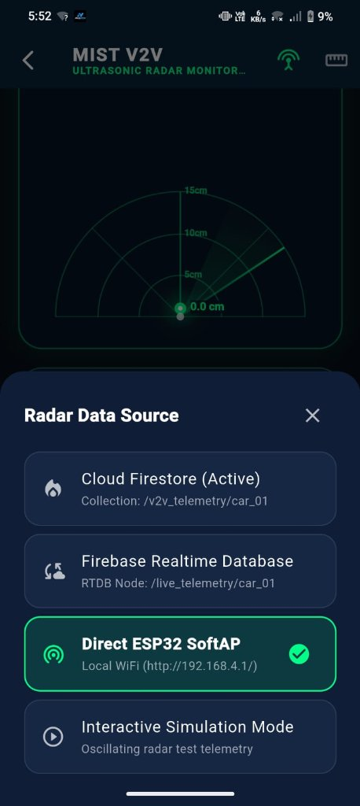

# 🚗 NeuroDrive: Intelligent Edge-Aware Driver Safety & V2V Proximity Radar System

[](https://flutter.dev)
[](https://dart.dev)
[](https://www.espressif.com/)
[](https://firebase.google.com/)
[](https://www.python.org/)
[](https://fastapi.tiangolo.com/)
[](https://huggingface.co/google/flan-t5-base)
[](LICENSE)

> **NeuroDrive** is a next-generation connected vehicular telematics and intelligent driver assistance platform. It bridges physical **Vehicle-to-Vehicle (V2V) ultrasonic radar hardware**, **on-device 50Hz sensor fusion**, **spatial geohashed road damage avoidance**, and **hybrid AI qualitative driving coaching** with server-authoritative cloud synchronization.

---

## 📸 System Showcase & Live Hardware

| ESP32 Dual-Node Hardware Testbed | MIST V2V Radar Mobile Cockpit |
| :---: | :---: |
|  |  |
| *Dual ESP32 nodes, HC-SR04 ultrasonic sensor, 16x2 I2C LCD & 0.96" OLED on vehicular testbed* | *Live sweeping radar canvas, real-time closing speed, target tracking & raw JSON diagnostics* |

| Multi-Source Radar Telemetry Switcher | Firebase Realtime Database Sync |
| :---: | :---: |
|  |  |
| *Seamless switching between Direct ESP32 SoftAP, Firebase RTDB, Firestore, & Interactive Sim* | *Ultra-low-latency bidirectional telemetry synchronization (`neurodrive-be33a`)* |

---

## 🌟 Key Highlights & Core Capabilities

- 🛰️ **Dual-Node ESP32 V2V Ultrasonic Radar**: Measures real-time obstacle closing distances via HC-SR04, rendered simultaneously on hardware (16x2 I2C LCD, 0.96" OLED) and streamed wirelessly over SoftAP / ESP-NOW.
- 📱 **MIST V2V Radar Monitoring Cockpit**: Custom 60fps Flutter animated sweeping radar arc (`RadarArcPainter`), live target blip plotting, dynamic threat color-coding (Safe / Caution / Critical), and instant closing-velocity tracking.
- 🗺️ **In-Map Live Forward Radar HUD**: Floating turn-by-turn navigation radar overlay with `RADAR ON / OFF` toggle pill, allowing drivers to monitor blind-spot proximity directly on Google Maps during navigation.
- 🔊 **Automated Proximity Warnings & Audio Alerts**: High-threat proximity conditions trigger instant Text-to-Speech (TTS) voice alerts (*"Warning: Obstacle detected within X centimeters"*), automatically logging incident telemetry to SQLite, SharedPreferences, and Cloud Firestore.
- ⚠️ **Geohashed Road Damage & Hazard Heatmap**: Queries 1,400+ authentic statewide Tamil Nadu road hazard data points with Geohash spatial bounding and heading vector dot-product filtering to suppress opposing-lane nuisance alarms.
- 🚨 **Multi-Stage Autonomous Crash Detection**: Discriminated crash filter combining sustained high-g deceleration ($|a| > 6.0g$ over 100ms) with velocity drop integration ($\Delta v > 15\text{ km/h}$) and GPS zero-speed confirmation, triggering an automated 15-second SOS abort countdown and cloud telephony dispatch.
- 🤖 **Hybrid AI Driving Coach**: Deterministic mathematical safety scoring coupled with HuggingFace FLAN-T5-base natural language processing for actionable, constructive post-trip driving critique.
- 🔮 **Draggable Holographic Neural Orb Copilot**: Interactive on-screen conversational AI driving assistant powered by Google Gemini.

---

## 🏛️ System Architecture

```mermaid
flowchart TD
    subgraph Hardware ["Hardware Layer (ESP32 V2V & Telemetry Node)"]
        US["HC-SR04 Ultrasonic Sensor (40kHz Burst)"]
        ESP1["ESP32 Transmitter Node (Local Sensor / SoftAP 192.168.4.1)"]
        ESP2["ESP32 Receiver Node (V2V Telemetry Relay / ESP-NOW)"]
        LCD["16x2 I2C LCD (PCF8574 - 0x27)"]
        OLED["0.96 inch I2C OLED (SSD1306 - 0x3C)"]
        
        US -->|Echo/Trig 50Hz| ESP1
        ESP1 -->|I2C 100kHz| LCD
        ESP1 -->|I2C 400kHz| OLED
        ESP1 <-->|ESP-NOW Low-Latency Link| ESP2
    end

    subgraph Client ["Client Device (Flutter Mobile App)"]
        UI["UI Cockpit (Home Dashboard, MIST Radar, Map View)"]
        SE["SafetyEngine (50Hz Inertial Fusion & Gravity Removal)"]
        V2V["V2VRadarService (ESP32 SoftAP / WebSocket / Firebase RTDB)"]
        RDS["RoadDamageService (Geohash Precision 6 + Bearing Filter)"]
        ES["EmergencyService (Crash Discrimination & SOS Dispatch)"]
        LS["LocalDatabaseService (SQLite Buffer & Offline Fallback)"]
        TTS["Text-To-Speech Audio Service (Proximity Voice Warnings)"]

        SE --> UI
        V2V <--> UI
        V2V --> TTS
        RDS --> UI
        ES --> UI
        UI --> LS
    end

    subgraph Cloud ["Cloud & Backend Infrastructure"]
        RTDB[("Firebase Realtime Database (neurodrive-be33a)")]
        FIRESTORE[("Cloud Firestore (User Profiles, Trips, Alerts)")]
        AUTH["Firebase Authentication (Bearer JWT)"]
        FASTAPI["AI Backend Service (FastAPI / Uvicorn)"]
        FLAN["FLAN-T5-base NLP Model (Worker Thread Pool)"]
        TWILIO["Telephony Gateway (Automated SOS SMS & Calls)"]
    end

    ESP1 -.->|HTTP /data or WS /ws| V2V
    ESP2 -.->|REST / Socket| RTDB
    V2V <-->|Realtime Telemetry Stream| RTDB
    LS <-->|Server-Authoritative Sync| FIRESTORE
    UI <--> AUTH
    LS -->|POST /analyze_trip (JWT)| FASTAPI
    FASTAPI --> FLAN
    FASTAPI -->|Admin SDK Verified Write| FIRESTORE
    ES -->|Emergency Webhook| FASTAPI
    FASTAPI --> TWILIO
```

---

## 🔌 Hardware Specifications & Wiring Pinout

The NeuroDrive physical subsystem consists of a dual-node ESP32 architecture tested on vehicular scale prototypes.

### Pinout Connection Table

| Peripheral | Peripheral Pin | ESP32 GPIO Pin | Description / Electrical Spec |
| :--- | :--- | :--- | :--- |
| **HC-SR04** | VCC | 5V / VIN | 5V DC Operating Voltage |
| **HC-SR04** | Trig | GPIO 5 | 10µs High Trigger Pulse |
| **HC-SR04** | Echo | GPIO 18 | TTL Echo Pulse Input (via voltage divider to 3.3V) |
| **HC-SR04** | GND | GND | Ground Reference |
| **16x2 LCD** | VCC | 5V / VIN | 5V Power for Backlight & Driver |
| **16x2 LCD** | GND | GND | Ground Reference |
| **16x2 LCD** | SDA | GPIO 21 | I2C Data Line (PCF8574 backpack, Addr `0x27`) |
| **16x2 LCD** | SCL | GPIO 22 | I2C Clock Line |
| **0.96" OLED** | VCC | 3.3V | 3.3V Clean Logic Power |
| **0.96" OLED** | GND | GND | Ground Reference |
| **0.96" OLED** | SDA | GPIO 21 | Shared I2C Data Line (SSD1306, Addr `0x3C`) |
| **0.96" OLED** | SCL | GPIO 22 | Shared I2C Clock Line |

### ESP32 Firmware Operation

1. **SoftAP Web Server**:
   - The ESP32 hosts a dedicated Wi-Fi Access Point: `ESP32-RADAR` (Default IP: `192.168.4.1`).
   - Telemetry endpoint: `http://192.168.4.1/data` returning real-time JSON:
     ```json
     {"local": 14.5}
     ```
2. **Dual-Screen Display**:
   - The 16x2 LCD displays continuous system status: `MIST V2V RADAR` on Line 1, and `Distance: 14.5 cm` on Line 2.
   - The 0.96" OLED presents an animated radar sweep graphic and instantaneous risk classification (`SAFE`, `CAUTION`, `CRITICAL`).

---

## 🛠️ How Problems Were Solved (Engineering Challenges & Edge Cases)

During development and live testbed validation, several critical engineering hurdles were solved:

### 1. Android 15 Cellular Routing Bypass on No-Internet ESP32 SoftAP
- **The Problem**: When an Android 15 phone connects to the ESP32's SoftAP (`192.168.4.1`), the OS recognizes that the Wi-Fi network lacks public internet access. Consequently, Android automatically routes all HTTP requests (`http://192.168.4.1/data`) out through 4G/5G mobile data, resulting in `SocketException: Connection timed out`.
- **The Solution**: 
  - Implemented an **Endpoint Auto-Discovery Engine** probing `/data`, `/distance`, `/read`, and `/ws` with short connection timeouts.
  - Added user guidance to toggle off mobile data or tap *"Stay connected"* on Android's captive portal prompt.
  - Implemented seamless 4-tier fallback routing: **Direct ESP32 SoftAP $\rightarrow$ Firebase Realtime Database $\rightarrow$ Cloud Firestore $\rightarrow$ Interactive Simulation Mode**.

### 2. Heterogeneous Hardware Payload Normalization
- **The Problem**: Different versions of the Arduino C++ firmware serialized distance using different keys (`{"local": 4.5}`, `{"distance_cm": 14.1}`, `{"dist": 10}`). The initial mobile UI showed `0.0 cm` because it strictly sought `distance_cm`.
- **The Solution**: Re-engineered `V2VTelemetry.fromMap()` with hierarchical priority resolution:
  ```dart
  // 1. Explicit key scanning
  final rawDist = map['local'] ?? map['distance_cm'] ?? map['distance'] ?? map['dist'];
  // 2. Generic numeric fallback scanner across all values
  if (rawDist == null) {
    for (final val in map.values) {
      if (val is num && val > 0 && val < 500) { distance = val.toDouble(); break; }
    }
  }
  ```

### 3. High-Performance In-Map Radar HUD without Frame Drops
- **The Problem**: Overlaying an animated 60fps radar canvas on top of a resource-heavy Google Maps navigation view caused UI stutter and dropped frames.
- **The Solution**: Encapsulated the radar canvas within a dedicated `RepaintBoundary` and implemented `RadarArcPainter` with lightweight trigonometry calculations, keeping map rendering on its own GPU layer.

### 4. Zero-Trust False Crash Rejection
- **The Problem**: A phone falling off a dashboard mount produces instantaneous deceleration spikes exceeding $8g$, which would falsely trigger 911 emergency calls.
- **The Solution**: Implemented a **multi-stage validation filter**:
  $$\text{Deceleration } |a| > 6.0g \quad \text{for } \Delta t \ge 100\text{ms} \quad \text{AND} \quad \Delta v > 15\text{ km/h} \quad \text{AND} \quad v_{\text{GPS}} \to 0$$
  Combined with a 15-second audible countdown abort dialog before automated dispatch.

### 5. Opposing-Lane Road Hazard Nuisance Alert Suppression
- **The Problem**: Potholes on the opposite side of a divided highway or on perpendicular streets within a 300m radius triggered false warnings.
- **The Solution**: Applied a directional vector dot-product filter:
  $$\vec{v}_{\text{car}} \cdot \vec{d}_{\text{hazard}} > 0.7$$
  Only hazards positioned directly within the vehicle's forward trajectory cone ($\approx \pm 45^\circ$) generate visual and auditory alerts.

---

## 📱 Mobile Application Architecture & Features

### 1. Home Telemetry Dashboard
- Displays instantaneous proximity distance formatted in meters and centimeters (e.g., `0.05 m (4.5 cm)`).
- Risk-based dynamic background coloration:
  - 🟢 **SAFE**: $> 15.0\text{ cm}$
  - 🟠 **CAUTION**: $10.0\text{ cm} - 15.0\text{ cm}$
  - 🔴 **CRITICAL**: $< 10.0\text{ cm}$
- Tap-to-Radar navigation directly opening the MIST Radar Cockpit.

### 2. MIST V2V Radar Cockpit (`v2v_radar_screen.dart`)
- **Radar Arc Canvas**: 180° forward arc with 5cm, 10cm, and 15cm range rings and an animated sweep beam.
- **Live Target Blip**: Plots obstacle coordinates with a glowing halo indicator.
- **Closing Velocity**: Computes dynamic closing speed ($\text{km/h}$) from consecutive distance derivative readings.
- **Raw Diagnostic Feed**: Real-time terminal output displaying raw incoming JSON payloads for field verification.

### 3. In-Map Navigation Radar HUD (`map_view_screen.dart`)
- Integrated into turn-by-turn driving navigation.
- Floating `RADAR ON / OFF` toggle button.
- Compact holographic radar HUD showing forward sector clearance without obstructing route turn indicators.

### 4. Automated Proximity Alerts & Persistence
- Automatically detects sustained critical proximity conditions.
- Uses `flutter_tts` to announce auditory alerts over vehicle speakers.
- Writes structured incident records to SQLite, `SharedPreferences`, and Cloud Firestore under `/users/{uid}/alerts`.

---

## 🧠 AI Backend & Safety Scoring (`ai_service`)

The backend microservice is built using **FastAPI** and integrates HuggingFace's **FLAN-T5-base** model for qualitative driving critique.

### Deterministic Safety Scoring Formula

To ensure 100% mathematical reproducibility and prevent LLM hallucinations from altering insurance scores:

$$\text{Safety Score} = \max\left(0, \min\left(100, 100 - \frac{15 \cdot N_{\text{brake}} + 10 \cdot N_{\text{accel}} + 12 \cdot N_{\text{turn}} + 0.5 \cdot T_{\text{speeding}}}{\text{Distance}_{\text{km}}}\right)\right)$$

### Server-Authoritative Cloud Writes

1. The client sends authenticated trip telemetry with a Firebase Auth Bearer JWT: `POST /analyze_trip`.
2. The backend validates the JWT, executes the deterministic scoring formula, and offloads FLAN-T5 qualitative text generation to a worker thread pool (`starlette.concurrency.run_in_threadpool`).
3. The verified score and commentary are written directly into Firestore via the Firebase Admin SDK, preventing any client-side score manipulation.

---

## 🚀 Getting Started

### Prerequisites

- **Flutter SDK**: `>= 3.5.0`
- **Dart SDK**: `>= 3.5.0`
- **Android SDK**: API 34+ (Android 14/15 tested)
- **Python**: `>= 3.10`
- **Hardware**: ESP32 Development Board, HC-SR04, I2C 16x2 LCD, I2C 0.96" OLED

---

### Step 1: Mobile App Setup (Flutter)

```bash
# Clone the repository
git clone https://github.com/Yogesh-Mohan/NeuroDrive.git
cd NeuroDrive

# Install Flutter dependencies
flutter pub get

# Verify environment & connected Android device
flutter doctor

# Run on connected device
flutter run
```

---

### Step 2: AI Backend Service Setup (Python FastAPI)

```bash
cd ai_service

# Create virtual environment
python -m venv venv
source venv/bin/activate  # On Windows: .\venv\Scripts\activate

# Install dependencies
pip install -r requirements.txt

# Start the FastAPI server
uvicorn api:app --host 0.0.0.0 --port 8000 --reload
```

---

### Step 3: Hardware Flashing (ESP32)

1. Open Arduino IDE or PlatformIO.
2. Install required libraries: `LiquidCrystal_I2C`, `Adafruit_SSD1306`, `WiFi`, `WebServer`.
3. Connect HC-SR04, LCD, and OLED according to the [Pinout Table](#pinout-connection-table).
4. Flash the firmware onto the ESP32.
5. Power up the board; verify that the SoftAP `ESP32-RADAR` broadcasts at `192.168.4.1`.

---

## 📂 Project Directory Structure

```plaintext
NeuroDrive/
├── android/                   # Native Android configuration & manifests
├── assets/
│   ├── data/
│   │   └── tamilnadu_road_damage.json  # 1400+ Geohashed hazard points
│   └── icon/                  # Application launcher assets
├── docs/                      # Architectural specifications & images
│   ├── images/
│   │   ├── esp32_hardware_setup.jpg    # Hardware testbed photo
│   │   ├── firebase_rtdb_console.png   # Firebase console snapshot
│   │   ├── mist_v2v_radar_ui.jpg       # MIST radar cockpit screenshot
│   │   └── radar_datasource_modal.jpg  # Telemetry source switcher
│   ├── neurodrive_architecture_spec.md
│   └── neurodrive_goldfish_review_report.md
├── lib/                       # Flutter core source code
│   ├── core/
│   │   ├── models/            # V2VTelemetry, TripModel, AlertModel
│   │   └── services/          # V2VRadarService, SafetyEngine, RoadDamageService
│   ├── screens/               # HomeDashboard, V2VRadarScreen, MapViewScreen
│   └── widgets/               # NeuralCopilotOrb, RadarArcPainter
├── pubspec.yaml               # Flutter package dependencies
└── README.md                  # Comprehensive Project Documentation
```

---

## 🛡️ License

This project is licensed under the **MIT License** — see the [LICENSE](LICENSE) file for details.

---

## 👥 Authors & Acknowledgments

- **Yogeshwarakannan M** ([@Yogesh-Mohan](https://github.com/Yogesh-Mohan)) — *Lead Developer & Hardware Architect*
- Built with ❤️ using Flutter, ESP32, Firebase, and Google DeepMind Antigravity.
