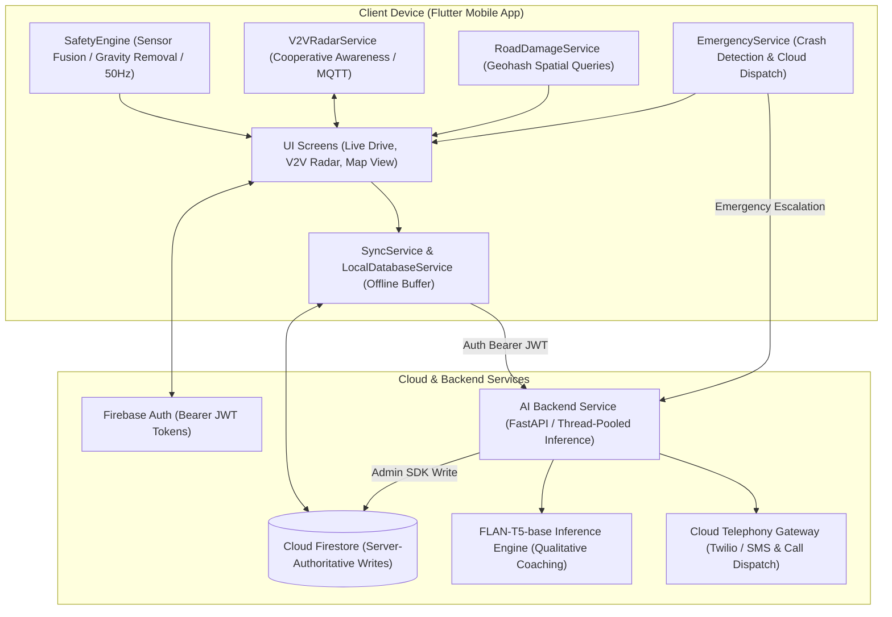
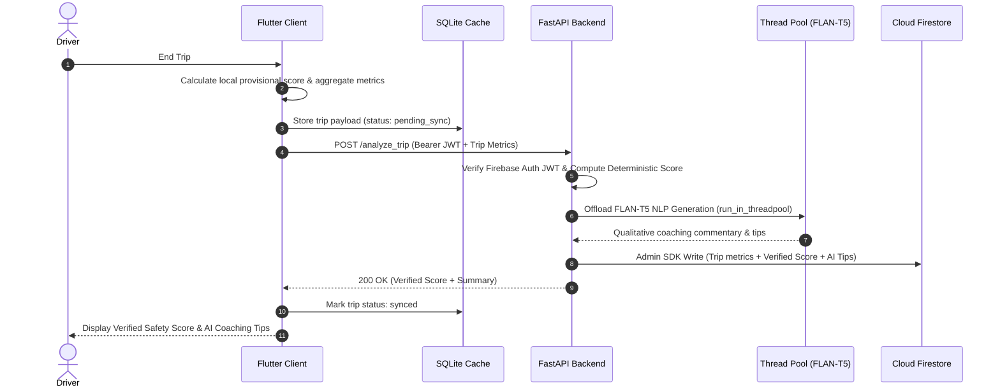

# NeuroDrive System Architecture Specification (v1.1.0 — Hardened Post-EGM Review)

## 1. System Overview & Problem Statement
NeuroDrive is an intelligent, edge-aware vehicular telemetry and driver safety platform. It combines on-device sensor fusion, Vehicle-to-Vehicle (V2V) Cooperative Situational Awareness, geofenced road hazard alerting (potholes/damage), and offline-first edge resilience with a hybrid AI backend (deterministic scoring + FLAN-T5 qualitative coaching) and server-authoritative Firebase synchronization.



---

## 2. Component Specifications

### 2.1 Frontend Architecture (`neuro_drive` Flutter Client)
* **Framework:** Flutter (Dart `>=3.5.0 <4.0.0`) targeting Android, iOS, Windows, and Web.
* **Core Modules & Responsibilities:**
  1. **`SafetyEngine` (`safety_engine.dart`):**
     * Samples inertial sensors at 50Hz using software sensor fusion (`userAcceleration` isolating linear acceleration from the $1.0\,g$ earth gravity vector).
     * Performs dynamic frame alignment: projects lateral/longitudinal acceleration onto the vehicle's forward vector using GPS velocity bearing.
     * Detects harsh events with sustained duration windows ($\ge 300\text{ms}$):
       * Hard Braking: $a_{\text{long}} < -3.5\,m/s^2$
       * Rapid Acceleration: $a_{\text{long}} > 3.0\,m/s^2$
       * Harsh Cornering: $|a_{\text{lat}}| > 4.0\,m/s^2$
  2. **`V2VRadarService` (`v2v_radar_service.dart`):**
     * **Operational Scope:** Cooperative Situational Awareness advisory layer (not autonomous forward collision avoidance).
     * **Transport:** Low-latency MQTT / WebSocket relay with geohash-partitioned pub/sub channels (`v2v/{geohash_6}`).
     * **Telemetry Packet Schema:**
       ```json
       {
         "vehicleId": "string",
         "timestamp": 1731700000000,
         "latitude": 13.0827,
         "longitude": 80.2707,
         "speedKmh": 52.4,
         "headingDeg": 182.5,
         "accelVector": [-0.2, 0.05, 0.0]
       }
       ```
     * Discards peers after 1500ms heartbeat timeout; warns driver of stationary/braking hazard vehicles within a 200m–500m geofence.
  3. **`RoadDamageService` (`road_damage_service.dart`):**
     * Implements Geohash-based spatial indexing (precision 6, ~1.2km cells) to query Firestore `road_damage`.
     * Caches active cells in local SQLite; only fetches from Firestore upon crossing cell boundaries.
     * Applies heading vector dot product filter ($\vec{v}_{\text{car}} \cdot \vec{d}_{\text{hazard}} > 0.7$) to suppress nuisance alerts from opposing lanes or cross-streets within a 300m radius.
  4. **`EmergencyService` (`emergency_service.dart`):**
     * Multi-stage crash discrimination:
       * Trigger: sustained deceleration $|a| > 6.0\,g$ over a 100ms window combined with an integrated velocity drop $\Delta v > 15\,\text{km/h}$ and GPS speed drop to zero (rejecting phone drop shock spikes).
       * 15-second visual and loud audio abort countdown.
     * **Dispatch Architecture:**
       * **Primary (Connected):** Dispatches authenticated payload to backend `/api/v1/emergency/dispatch` which triggers automated Twilio/SMS calls with real-time GPS tracking link.
       * **Fallback (Offline):** Launches native OS emergency dialer (`url_launcher` intent) pre-populated with emergency numbers and coordinates.
  5. **`SyncService` (`sync_service.dart`):**
     * Backed by `sqflite` transaction buffer.
     * Exponential backoff retry strategy with jitter: $t = \min(300, 2^{\text{attempt}} \times 2) \pm \text{jitter}$.
     * Enforces append-only immutable trip submissions.

---

### 2.2 AI Telemetry Backend (`ai_service` FastAPI)
* **Framework:** FastAPI (Python 3.10+ / Uvicorn).
* **Concurrency Architecture:** PyTorch FLAN-T5 inference offloaded to worker thread pools via `starlette.concurrency.run_in_threadpool` to prevent asyncio event loop starvation.
* **Authentication:** Enforced Firebase ID Token verification (`Authorization: Bearer <token>`) validated via `firebase-admin`.
* **Deterministic Safety Scoring Algorithm:**
  $$Score = \max\left(0, \min\left(100, 100 - \frac{15 \cdot N_{\text{brake}} + 10 \cdot N_{\text{accel}} + 12 \cdot N_{\text{turn}} + 0.5 \cdot T_{\text{speeding}}}{\text{Distance}_{\text{km}}}\right)\right)$$
* **FLAN-T5-base Qualitative Inference:**
  * Uses constrained prompt templates to generate qualitative behavior critiques, driving habit summaries, and actionable safety tips.
  * Rigid fallback parsing ensures graceful degradation if LLM output fails validation.
* **Server-Authoritative Writes:**
  * FastAPI server writes the verified `safety_score` and AI commentary directly into Firestore `/users/{userId}/trips/{tripId}` using Firebase Admin credentials.

---

### 2.3 Cloud & Storage Topology (Google Firebase)
* **Authentication:** Firebase Auth with role-based custom claims (`admin: boolean`).
* **Firestore Schema & Rules:**
  * `/users/{userId}`: User profile, vehicle info, emergency contacts. (Read/Write: `request.auth.uid == userId`).
  * `/users/{userId}/trips/{tripId}`: Aggregated trip metrics, event markers, safety score.
    * Client permission: Create only (`request.auth.uid == userId && !('safety_score' in request.resource.data))`.
    * Score mutation: Restricted to backend service account.
  * `/road_damage/{damageId}`: `GeoPoint`, `geohash` (string), `severity`, `source`. (Public read, authenticated write).
* **Document Ceiling Mitigation:** Raw 50Hz telemetry arrays are aggregated on-device. If high-resolution breadcrumb traces are needed, they are compressed as gzipped JSON blobs in Firebase Cloud Storage, with only the download URL stored in the Firestore trip document.

---

## 3. Sequence: Server-Authoritative Trip Finalization


---

## 4. Hardened Non-Functional Requirements & Performance Targets
* **Edge Sensor Sampling & Processing:** 50Hz sensor fusion execution with $< 20\text{ms}$ calculation latency.
* **V2V Awareness Broadcast Rate:** 2Hz–5Hz MQTT publish frequency over 4G/5G; situational alerts triggered within $< 300\text{ms}$.
* **Trip Analysis Throughput:** API latency $\le 2.5\text{s}$ under multi-thread pooling; 0% event loop blocking.
* **Crash False-Alarm Rejection:** Zero false triggers from standard phone drop shocks ($< 25\text{ms}$ duration).
* **Battery Budget:** Mobile client background driving consumption constrained to $< 6.5\%$ battery drain per driving hour via Android Foreground Service.
